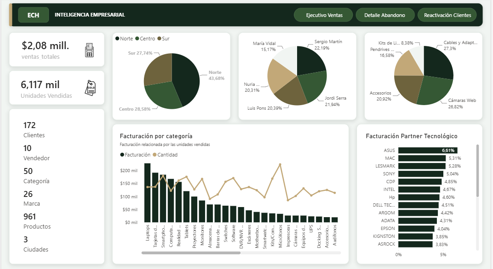
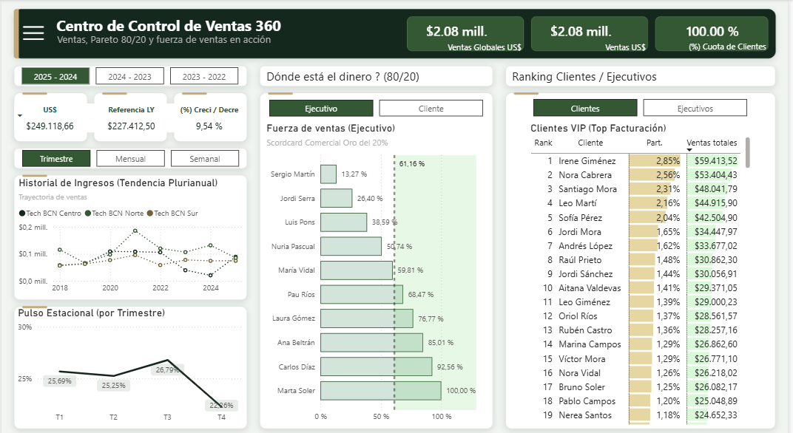

# Análisis de ventas, churn y reactivación de clientes en Power BI

Proyecto de análisis para **EuroComplice S.L.**, una empresa de tecnología con tres agencias en Barcelona y ventas entre 2018 y 2025. Construí cuatro paneles en Power BI que responden a cuatro preguntas: cómo van las ventas, dónde se concentra el negocio, cuántos clientes se están perdiendo y qué se puede hacer para recuperarlos.

Además del reporte, el repositorio incluye el código **DAX** (una medida por archivo, comentada), la consulta de **Power Query** y unos scripts de **Python y SQL** con los que comprobé que las cifras del reporte son correctas.

## Los cuatro paneles

| | |
|---|---|
| **1. Cuadro de mando.** Ventas, unidades y reparto por agencia, ejecutivo, categoría y marca.<br>[Ver cómo se hizo →](paneles/01_cuadro_mando/README.md) |  |
| **2. Detalle de ventas global.** Crecimiento, estacionalidad, Pareto 80/20 y clientes VIP.<br>[Ver cómo se hizo →](paneles/02_detalle_ventas_global/README.md) |  |
| **3. Abandono de clientes.** Churn, retención y comparación con el año anterior.<br>[Ver cómo se hizo →](paneles/03_abandono_clientes/README.md) |  |
| **4. Reactivación de clientes.** A quién llamar primero y cuánto se puede gastar en recuperarlos.<br>[Ver cómo se hizo →](paneles/04_reactivacion_clientes/README.md) |  |

---

## Preguntas de negocio y respuestas

### 1. ¿Cómo van las ventas y la fuerza comercial?

- Se facturaron **$2,08 millones** (1,81 millones sin IVA) en 6.117 unidades, a 172 clientes y con 10 ejecutivos.
- En el último periodo se vendieron **$249 mil frente a $227 mil** del año anterior: un **+9,54 %**.
- Por agencia: **Norte 43,7 %**, Centro 28,6 % y Sur 27,7 %.
- **Concentración:** 82 de los 172 clientes (48 %) generan el 80 % de la venta. Entre los ejecutivos el reparto es parejo: ninguno supera el 13,3 % y los cinco primeros suman ≈ 60 %.
- **Estacionalidad:** el tercer trimestre es el más fuerte (≈ 26,8 %) y el cuarto el más débil (≈ 22 %).

→ [Panel 1](paneles/01_cuadro_mando/README.md) y [panel 2](paneles/02_detalle_ventas_global/README.md).

### 2. ¿Dónde se está perdiendo dinero por abandono de clientes?

- Con un umbral de **120 días**, el **churn es del 88,95 %** (153 de 172 clientes) y la retención del **11,05 %**.
- Es **3,5 puntos porcentuales mejor** que el año anterior (92,50 %), y la base de clientes creció un 7,5 %.
- Hay que leerlo con cuidado: la mediana entre dos compras de un mismo cliente es de unos 22 meses, así que un 89 % no significa perder 9 de cada 10 clientes, sino que con 120 días medimos "no ha vuelto en 4 meses". El umbral debe fijarse con el negocio (con 180 días el churn baja al 83 %).
- Lo urgente es un grupo pequeño: **29 clientes que compraron en los últimos 12 meses y acaban de cruzar el umbral**, con **$200,78 mil** en compras anuales.

→ [Panel 3](paneles/03_abandono_clientes/README.md).

### 3. ¿Qué se propone para reactivar clientes?

| Paso | Cifra |
|---|---|
| Clientes en churn | 153 |
| Con compras en los últimos 12 meses (población objetivo) | **29** |
| Base en riesgo (sus compras de 12 meses) | **$200,78 mil** |
| Ingreso recuperable (30 % de conversión) | $60,24 mil |
| Valor recuperable (20 % de margen) | **$12,05 mil** |
| Clientes que se espera recuperar | 9 |
| **CPA máximo permitido** | **≈ $1,38 mil por cliente recuperado** (≈ $415 por cliente contactado) |

**Acciones propuestas**

1. **Esta semana:** llamada personal a los 5 clientes "valor reciente + fácil" (acaban de cruzar el umbral) y a los 6 de mayor valor, que concentran el 56 % de la base.
2. **Piloto de 30 días** con un tope de ≈ $12 mil, midiendo la conversión real para ajustar el 30 % supuesto. No invertir en los 97 clientes dormidos crónicos.

→ [Panel 4](paneles/04_reactivacion_clientes/README.md).

### 4. ¿Qué tan fiables son las cifras?

Recalculé las cifras clave por separado en Python y SQL y las comparé con una cifra de control.

| Control (sin filtros) | Valor |
|---|---|
| Líneas de venta / facturas / clientes | 961 / 320 / 172 |
| `ventas_netas` | 1.811.167,84 |
| `iva_usd` (15 %) | 271.675,18 |
| **`ventas_totales`** | **2.082.843,02** |
| Churn con umbral 120 y corte 05/09/2025 | 88,95 % (153 de 172) |
| Churn del año anterior (mismo criterio) | 92,50 % (160 clientes) |

El IVA del modelo es del **15 %** (Ecuador). El archivo original trae el 21 % (España) y se ajusta en Power Query; por eso la columna `Total` del archivo (2.191.513,09) no se usa.

---

## Errores que encontré y cómo los resolví

| # | Problema | Causa | Solución |
|---|---|---|---|
| 1 | Importes **100 veces** mayores | Power Query leía `"$124.43"` con una configuración regional donde el punto separa miles | Convertir `Precio` y `Total` en un paso aparte con configuración regional `en-US`, sin tocar `Fecha` |
| 2 | Dos tarjetas con totales distintos (2,19 y 2,08 millones) | Una sumaba la columna `Total` del archivo (IVA 21 %) y la otra la medida (IVA 15 %) | Usar solo `[ventas_totales]` |
| 3 | El resultado cambiaba según el día en que se abría el reporte | `Fecha_Ref` usaba `TODAY()` | Anclar la fecha a la última venta |
| 4 | Las flechas "vs año anterior" siempre salían al alza | Se calculaban con el valor del año anterior | Variación = actual − año anterior, en puntos porcentuales |
| 5 | Ranking de valor en `1, 1, 1...` | `ALLSELECTED` sobre una columna de otra tabla | Iterar sobre la misma columna que muestra la tabla |
| 6 | CPA unas 5 veces más bajo de lo real | Conversión aplicada a 153 clientes, con el dinero de solo 29 | Misma población en numerador y denominador |
| 7 | El segmento "Dormido crónico" salía vacío al filtrarlo | Texto distinto entre la tabla del segmentador y la medida | Textos idénticos |

El razonamiento de cada diagnóstico está en [`docs/05_lecciones_aprendidas.md`](docs/05_lecciones_aprendidas.md).

---

## Modelo de datos

Esquema en estrella: `Analisis_Ventas` como tabla de hechos y dimensiones de calendario, agencias, categorías, marcas, clientes y vendedores. Más detalle en [`docs/02_modelo_de_datos.md`](docs/02_modelo_de_datos.md).

## Estructura del repositorio

```
├── README.md
├── img/
│   └── paneles/               capturas de los cuatro paneles
├── datos/                     datos de origen en .csv
├── powerbi/                   archivo .pbix
├── paneles/                   un README por panel con sus KPI y cómo se implementaron
│   ├── 01_cuadro_mando/
│   ├── 02_detalle_ventas_global/
│   ├── 03_abandono_clientes/
│   └── 04_reactivacion_clientes/
├── codigo/
│   ├── dax/                   una medida por archivo
│   ├── powerquery/            consulta M con la limpieza de datos
│   ├── python/                validaciones independientes
│   ├── sql/                   churn en SQL
│   └── tests/                 pruebas automáticas
└── docs/                      modelo, churn y RFM, lecciones aprendidas, glosario...
```

## Cómo usar el repositorio

**Explorar el tablero.** Abre el archivo de [`powerbi/`](powerbi/) con Power BI Desktop (solo Windows). Todas las medidas están también en [`codigo/dax/`](codigo/dax/README.md).

**Practicar con los datos.** [`datos/ventas_tecnologia_barcelona.csv`](datos/) contiene los datos originales sin tratar. En [`datos/README.md`](datos/README.md) explico las transformaciones que apliqué.

**Reproducir las validaciones.**

```bash
pip install -r requirements.txt

# Calidad de los datos y cifra de control del modelo (IVA 15 %)
python codigo/python/validar_calidad_datos.py --iva 0.15 --corregir-agencias

# Churn total y por categoría; sensibilidad al umbral
python codigo/python/validar_churn.py --umbral 120 --modo correcto
python codigo/python/validar_churn.py --sensibilidad 30,60,90,120,180

# Lo mismo en SQL, comparado contra pandas
python codigo/python/ejecutar_sql.py --umbral 120 --comparar

# Pruebas automáticas
pip install pytest && pytest -v
```

## Supuestos y límites

- La tasa de conversión (30 %) y el margen (20 %) del panel de reactivación son supuestos de trabajo; con un piloto real se ajustarían.
- Los importes del tablero incluyen IVA. Para decidir sobre margen convendría usar `ventas_netas`.

## Próximos pasos

- Publicar el reporte en Power BI Service con actualización programada.
- Añadir una página de seguimiento del piloto de reactivación (conversión real frente a la supuesta).

## Licencia

[MIT](LICENSE)
