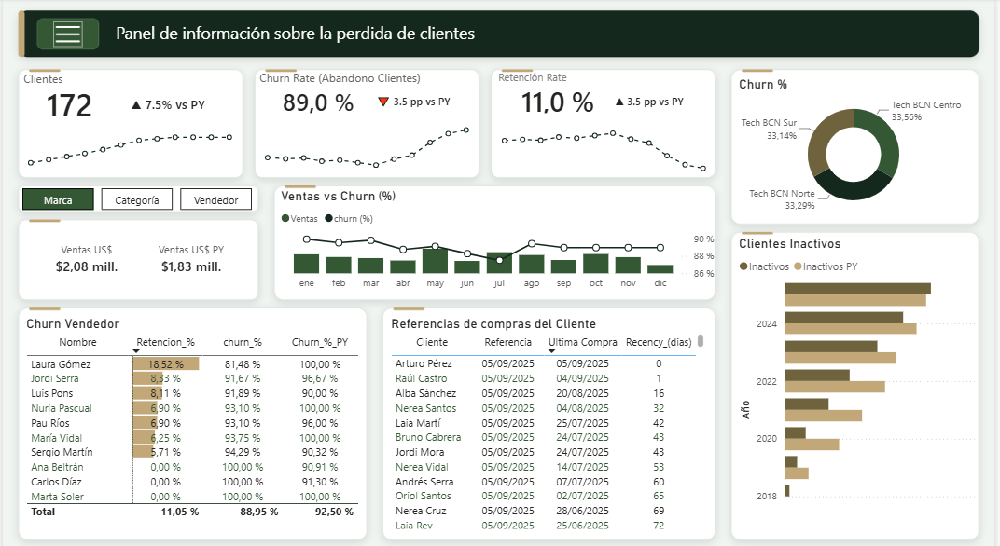
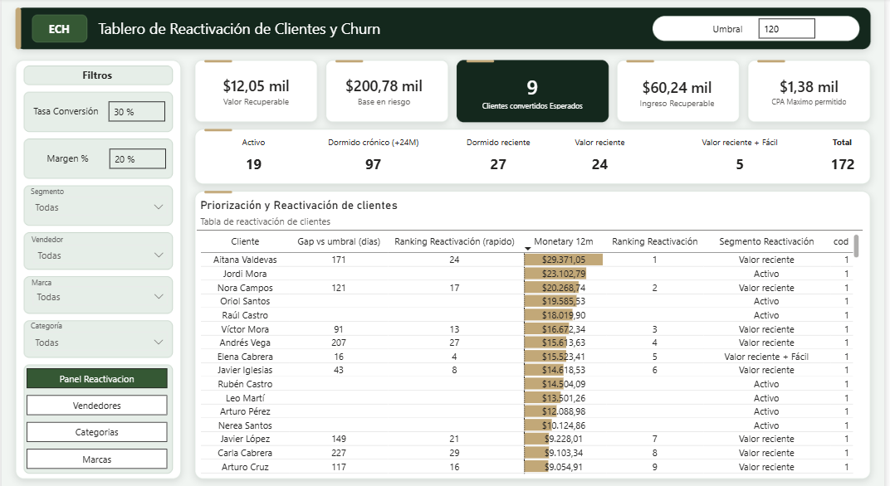

# Análisis de ventas, churn y reactivación de clientes — Power BI

Cuatro paneles en **Power BI** para una cadena ficticia de tecnología (2018–2025): un cuadro de mando ejecutivo, un centro de control de ventas, un panel de **abandono de clientes (churn)** y un tablero de **reactivación** con simulador de ROI. Incluye todo el código **DAX** (una medida por archivo, comentado en español), **Power Query**, y scripts de **Python y SQL** que validan las cifras de forma independiente.

## Los cuatro paneles

| | |
|---|---|
| **1. Cuadro de mando** — ventas, unidades y reparto por agencia, ejecutivo, categoría y marca.<br>[Cómo se hizo →](paneles/01_cuadro_mando/README.md) |  |
| **2. Detalle de ventas global** — crecimiento, estacionalidad, Pareto 80/20 y clientes VIP.<br>[Cómo se hizo →](paneles/02_detalle_ventas_global/README.md) |  |
| **3. Abandono de clientes** — churn, retención y comparación con el año anterior.<br>[Cómo se hizo →](paneles/03_abandono_clientes/README.md) |  |
| **4. Reactivación de clientes** — a quién llamar primero y cuánto se puede gastar.<br>[Cómo se hizo →](paneles/04_reactivacion_clientes/README.md) |  |

---

## Preguntas de negocio y respuestas

### 1. ¿Cómo van las ventas globales y la fuerza comercial?

- Se facturaron **$2,08 millones** (1,81 millones sin IVA) en 6,117 unidades, a 172 clientes y con 10 ejecutivos.
- En el último periodo, **$249 mil frente a $227 mil** del año anterior: **+9.54 %**.
- Por agencia: **Norte 43.7 %**, Centro 28.6 %, Sur 27.7 %.
- **Concentración:** 82 de 172 clientes (48 %) generan el 80 % de la venta. Entre los ejecutivos el reparto es parejo: ninguno supera el 13.3 %, y los cinco primeros suman ≈ 60 %.
- Estacionalidad: el tercer trimestre es el más fuerte (≈ 26.8 %) y el cuarto el más débil (≈ 22 %).

→ Detalle en el [panel 1](paneles/01_cuadro_mando/README.md) y el [panel 2](paneles/02_detalle_ventas_global/README.md).

### 2. ¿Dónde se está perdiendo dinero por abandono de clientes?

- Con un umbral de **120 días**, el **churn es 88.95 %** (153 de 172 clientes) y la retención **11.05 %**.
- Es **3.5 puntos porcentuales mejor** que el año anterior (92.50 %), y la base de clientes creció 7.5 %.
- Ojo con la lectura: la mediana entre dos compras de un mismo cliente es de ~22 meses, así que **89 % no significa perder 9 de cada 10 clientes**; significa que con 120 días medimos "no ha vuelto en 4 meses". El umbral debe fijarse con el negocio (con 180 días el churn baja a 83 %).
- Lo urgente es un grupo pequeño: **29 clientes que compraron en los últimos 12 meses y acaban de cruzar el umbral**, con **$200,78 mil** en compras anuales.

→ Detalle en el [panel 3](paneles/03_abandono_clientes/README.md).

### 3. ¿Qué plan se propone para reactivar clientes?

| Paso | Cifra |
|---|---|
| Clientes en churn | 153 |
| Con compras en los últimos 12 meses (población objetivo) | **29** |
| Base en riesgo (sus compras de 12 meses) | **$200,78 mil** |
| Ingreso recuperable (30 % de conversión) | $60,24 mil |
| Valor recuperable (20 % de margen) | **$12,05 mil** |
| Clientes que se espera recuperar | 9 |
| **CPA máximo permitido** | **≈ $1,38 mil por cliente recuperado** (≈ $415 por cliente contactado) |

**Acciones propuestas:**
1. **Esta semana:** llamada personal a los 5 clientes "valor reciente + fácil" (acaban de cruzar el umbral) y a los 6 de mayor valor, que concentran el 56 % de la base.
2. **Piloto de 30 días** con un tope de ≈ $12 mil, midiendo la conversión real para ajustar el 30 % supuesto. No invertir en los 97 dormidos crónicos.

→ Detalle en el [panel 4](paneles/04_reactivacion_clientes/README.md).

### 4. ¿Qué tan fiables son los números?

Cada cifra clave se **recalcula de forma independiente** en Python y SQL, y todas las medidas se comparan contra una cifra de control.

| Control (sin filtros) | Valor |
|---|---|
| Líneas de venta / facturas / clientes | 961 / 320 / 172 |
| `ventas_netas` | 1,811,167.84 |
| `iva_usd` (15 %) | 271,675.18 |
| **`ventas_totales`** | **2,082,843.02** |
| Churn con umbral 120 y corte 05/09/2025 | 88.95 % (153 de 172) |
| Churn del año anterior (mismo criterio) | 92.50 % (160 clientes) |

El **IVA es del 15 %** (Ecuador). El archivo original traía 21 % (España) y se adaptó en Power Query; por eso la columna `Total` del archivo (2,191,513.09) **no se usa**.

---

## Modelo de datos

Esquema en estrella: `Analisis_Ventas` como tabla de hechos y dimensiones de calendario, agencias, categorías, marcas, clientes y vendedores. Detalle en [`docs/02_modelo_de_datos.md`](docs/02_modelo_de_datos.md).

<!-- PENDIENTE (img/modelo/modelo_estrella.png):  -->

## Errores encontrados y cómo se resolvieron

| # | Problema | Causa | Solución |
|---|---|---|---|
| 1 | Importes **100 veces** mayores (219 millones en lugar de 2,19) | Power Query leía `"$124.43"` con una configuración regional donde el punto separa miles | Convertir `Precio` y `Total` aparte, con configuración regional `en-US` (sin tocar `Fecha`) |
| 2 | Dos tarjetas con totales distintos (2,19 y 2,08 millones) | Una sumaba la columna `Total` del archivo (IVA 21 %) y la otra la medida (IVA 15 %) | Usar solo `[ventas_totales]` y no cargar la columna `Total` |
| 3 | El resultado cambiaba según el día en que se abría el reporte | `Fecha_Ref` usaba `TODAY()` | Anclar la fecha a la última venta |
| 4 | Las flechas "vs PY" siempre salían 🔺 | Se calculaban con el valor del año anterior | Variación = actual − PY, en puntos porcentuales |
| 5 | Ranking de valor en `1, 1, 1...` | `ALLSELECTED` sobre una columna de otra tabla | Iterar sobre la misma columna que muestra la tabla |
| 6 | CPA ≈ 5 veces más bajo de lo real | Conversión aplicada a 153 clientes, pero el dinero era de 29 | Misma población en numerador y denominador |
| 7 | El segmento "Dormido crónico" salía vacío al filtrarlo | Texto distinto entre la tabla del segmentador y la medida | Textos idénticos |

<!-- PENDIENTE (img/modelo/powerquery_pasos_aplicados.png):  -->
<!-- PENDIENTE (img/errores/error_01_importes_x100_antes.png y _despues.png):   -->

Detalle completo, con el razonamiento de cada diagnóstico, en [`docs/05_lecciones_aprendidas.md`](docs/05_lecciones_aprendidas.md).

---

## Estructura del repositorio

```
├── README.md                  <- esta página
├── img/                       <- capturas (paneles, modelo, errores, lienzos)
├── datos/                     <- datos de origen en .csv (para practicar)
├── powerbi/                   <- archivo .pbix
├── paneles/                   <- un README por panel: KPI y cómo se implementaron
│   ├── 01_cuadro_mando/
│   ├── 02_detalle_ventas_global/
│   ├── 03_abandono_clientes/
│   └── 04_reactivacion_clientes/
├── codigo/
│   ├── dax/                   <- una medida por archivo, comentada en español
│   ├── powerquery/            <- consulta M con la limpieza de datos
│   ├── python/                <- validaciones independientes
│   ├── sql/                   <- churn en SQL (SQLite)
│   └── tests/                 <- pruebas automáticas
└── docs/                      <- documentación: modelo, glosario, lecciones, entrevista...
```

## Cómo usarlo

**Explorar el tablero.** Descarga [`powerbi/`](powerbi/) y ábrelo con Power BI Desktop (solo Windows). Las medidas están en [`codigo/dax/`](codigo/dax/README.md).

**Practicar con los datos.** [`datos/ventas_tecnologia_barcelona.csv`](datos/) trae los datos originales en bruto (con IVA 21 %). Lee [`datos/README.md`](datos/README.md) antes de usarlos: explica el IVA, las fechas y la limpieza.

**Reproducir las validaciones.**

```bash
git clone https://github.com/<tu-usuario>/analisis-ventas-churn-powerbi.git
cd analisis-ventas-churn-powerbi
pip install -r requirements.txt

# Calidad de los datos y cifra de control del modelo (IVA 15 %)
python codigo/python/validar_calidad_datos.py --iva 0.15 --corregir-agencias

# Churn total y por categoría; sensibilidad al umbral
python codigo/python/validar_churn.py --umbral 120 --modo correcto
python codigo/python/validar_churn.py --sensibilidad 30,60,90,120,180

# Lo mismo en SQL, comparado contra pandas
python codigo/python/ejecutar_sql.py --umbral 120 --comparar

# Pruebas automáticas
pip install pytest && pytest -v
```

## Limitaciones

- Datos sintéticos de un curso: no representan un negocio real.
- La tasa de conversión (30 %) y el margen (20 %) del panel de reactivación son **supuestos** que habría que calibrar con un piloto.
- Los importes del modelo incluyen IVA; para decisiones de margen convendría usar la venta neta.
- El umbral de abandono (120 días) se eligió para el ejercicio; en un negocio real se definiría con el equipo comercial.

## Documentación adicional

| Documento | Para qué |
|---|---|
| [`docs/03_diccionario_de_medidas.md`](docs/03_diccionario_de_medidas.md) | Catálogo de medidas |
| [`docs/04_churn_y_rfm_explicado.md`](docs/04_churn_y_rfm_explicado.md) | Churn y RFM en lenguaje sencillo |
| [`docs/05_lecciones_aprendidas.md`](docs/05_lecciones_aprendidas.md) | Errores y cómo se resolvieron |
| [`docs/06_checklist_de_revision.md`](docs/06_checklist_de_revision.md) | Lista para revisar cualquier reporte |
| [`docs/07_preparacion_entrevista.md`](docs/07_preparacion_entrevista.md) | Preguntas y respuestas sobre el proyecto |
| [`docs/09_glosario.md`](docs/09_glosario.md) | Términos usados |
| [`ROADMAP.md`](ROADMAP.md) | Próximos pasos |

## Créditos y licencia

Proyecto construido siguiendo el curso `[nombre del curso y autor]` de Udemy. Las correcciones, validaciones en Python/SQL, la adaptación del IVA y la documentación son propias.

Código y documentación: [MIT](LICENSE). Los datos de origen pertenecen al curso; ver [`datos/README.md`](datos/README.md).
