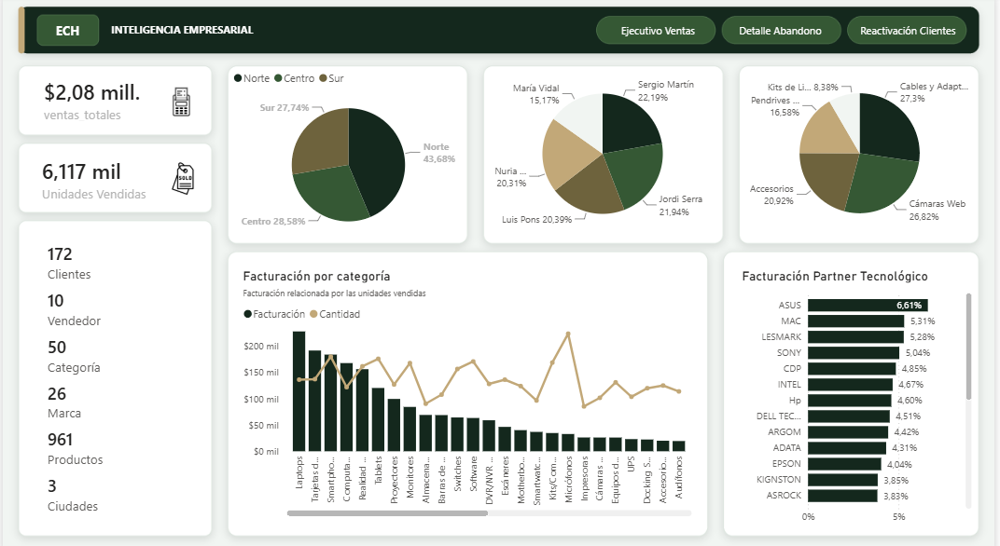

# Panel 1 — Cuadro de mando Eurocomplice S.L.

Es la **portada ejecutiva**: en una sola pantalla responde "¿cuánto vendemos, a quién, quién lo vende y qué se vende?". Desde aquí se navega a los otros tres paneles.



## Qué pregunta responde

- ¿Cuánto hemos facturado y cuántas unidades se han vendido?
- ¿Cómo se reparten las ventas por **agencia**, **ejecutivo**, **categoría** y **marca**?
- ¿De qué tamaño es el negocio (clientes, vendedores, categorías, marcas)?

## KPI y visuales

| Visual | Qué muestra | Medida / campo | Código |
|---|---|---|---|
| Tarjeta "ventas totales" | **$2,08 mill.** (con IVA 15 %) | `ventas_totales` | [`ventas_totales.dax`](../../codigo/dax/Medidas_base_facturacion/ventas_totales.dax) |
| Tarjeta "Unidades vendidas" | 6,117 unidades | `unidades_vendidas` | [`unidades_vendidas.dax`](../../codigo/dax/Medidas_base_facturacion/unidades_vendidas.dax) |
| Lista de conteos | 172 clientes, 10 vendedores, 50 categorías, 26 marcas, 961 productos (líneas de venta), 3 ciudades | Recuento distinto de cada columna | [`numero_clientes_unicos.dax`](../../codigo/dax/Medidas_participacion_ranking/numero_clientes_unicos.dax) |
| Pastel por agencia | Norte 43.7 %, Centro 28.6 %, Sur 27.7 % | `ventas_totales` por `DIM_Agencias` | — |
| Pastel "Ejecutivo Ventas" | Reparto de ventas por ejecutivo | `ventas_totales` por vendedor | — |
| Pastel "Detalles Categorías" | Reparto de ventas por categoría | `ventas_totales` por categoría | — |
| Barras + línea "Facturación por categoría" | Facturación (barras) frente a unidades (línea) por categoría | `ventas_totales` y `unidades_vendidas` | — |
| Barras "Facturación Partner Tecnológico" | % de facturación por marca (ASUS 6.61 %, MAC 5.31 %, LESMARK 5.28 %...) | `ventas_totales` por marca, como % del total | — |
| Botones superiores | Navegación a "Ejecutivo Ventas" (panel 2), "Detalle Abandono" (panel 3) y "Reactivación Clientes" (panel 4) | Botones de navegación de página | — |

## Cómo se construyó

1. **Lienzo.** Fondo verde oscuro con detalle dorado, como imagen de fondo de la página, para mantener la misma identidad visual en los cuatro paneles.
2. **Tarjetas** con las dos medidas base (`ventas_totales`, `unidades_vendidas`) y los iconos como imágenes.
3. **Gráficos de pastel** por agencia, vendedor y categoría, con `ventas_totales` como valor y etiquetas en porcentaje.
4. **Combinado barras + línea** (categoría en el eje; facturación en columnas y unidades en la línea con eje secundario).
5. **Botones de navegación** a los otros paneles.

## Decisiones y cuidados

- **Una sola fuente para el total.** Esta tarjeta mostraba antes 2,19 millones porque sumaba la columna `Total` del archivo (calculada con IVA 21 %), mientras el resto del reporte usaba `[ventas_totales]` (IVA 15 %). Pasé la tarjeta a la medida; la columna `Total` del archivo no se utiliza. Más detalle en las [lecciones aprendidas](../../docs/05_lecciones_aprendidas.md).
- Los importes se validan contra el archivo de origen: `ventas_totales` sin filtros da **2.082.843,02**.

## Cómo verificarlo

```bash
python codigo/python/validar_calidad_datos.py --iva 0.15 --corregir-agencias
```

El script informa 961 filas, 320 facturas y 172 clientes, y la **cifra de control del modelo**: ventas netas 1.811.167,84 · IVA 271.675,18 · ventas totales **2.082.843,02**.

← [Volver al README principal](../../README.md) · Siguiente: [Panel 2 — Detalle de ventas global](../02_detalle_ventas_global/README.md)
