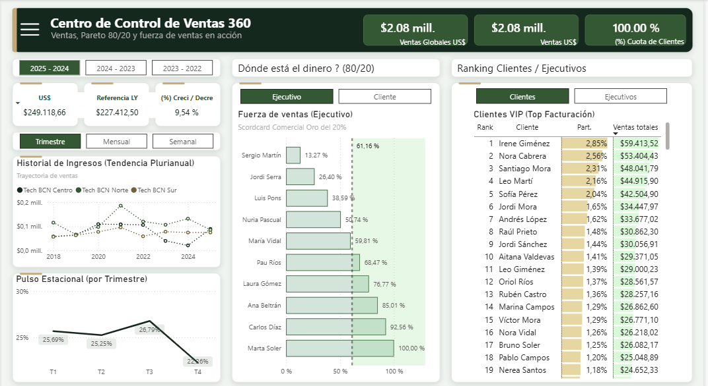

# Panel 2 — Detalle de ventas global ("Centro de Control de Ventas 360")

Profundiza en **cómo va el dinero**: crecimiento frente al año anterior, evolución por agencia, estacionalidad, concentración 80/20 de ejecutivos y clientes, y ranking de clientes VIP.

## Qué pregunta responde

- ¿Estamos creciendo frente al año anterior?
- ¿En qué trimestre se vende más?
- ¿Dónde está el dinero: qué ejecutivos y qué clientes concentran la venta (regla 80/20)?
- ¿Quiénes son los clientes que más facturan?

## KPI y visuales

| Visual | Qué muestra | Medida | Código |
|---|---|---|---|
| Tarjetas superiores "Ventas Globales US$" y "Ventas US$" | **$2,08 mill.** (las dos deben coincidir) | `ventas_totales` | [`ventas_totales.dax`](../../codigo/dax/Medidas_base_facturacion/ventas_totales.dax) |
| "(%) Cuota de Clientes" | 100 % sin filtros | `%_participacion_cliente` | [`pct_participacion_cliente.dax`](../../codigo/dax/Medidas_participacion_ranking/pct_participacion_cliente.dax) |
| "US$" del periodo | $249,118.66 (periodo seleccionado) | `ventas_totales` | [`ventas_totales.dax`](../../codigo/dax/Medidas_base_facturacion/ventas_totales.dax) |
| "Referencia LY" | $227,412.50 (mismo periodo, año anterior) | `ventas_totales_ly` | [`ventas_totales_ly.dax`](../../codigo/dax/Medidas_Inteligencia_Tiempo/ventas_totales_ly.dax) |
| "(%) Creci / Decre" | **+9.54 %** | `crecimiento_yoy` | [`crecimiento_yoy.dax`](../../codigo/dax/Medidas_Inteligencia_Tiempo/crecimiento_yoy.dax) |
| "Historial de ingresos" | Líneas por agencia, con botones Trimestre / Mensual / Semanal | `ventas_totales` por `DIM_Calendario` | — |
| "Pulso estacional" | % de ventas de cada trimestre (T3 ≈ 26.8 %, T4 ≈ 22 %) | `%_participacion_ventas` | [`pct_participacion_ventas.dax`](../../codigo/dax/Medidas_participacion_ranking/pct_participacion_ventas.dax) |
| "Dónde está el dinero (80/20)" — Ejecutivo | Barra con el % **acumulado** por ejecutivo; la línea punteada marca la referencia del Pareto | `%_acum_pareto_vendedor`, `ranking_ventas_vendedor` | [`pct_acum_pareto_vendedor.dax`](../../codigo/dax/Medidas_participacion_ranking/pct_acum_pareto_vendedor.dax) |
| "Dónde está el dinero (80/20)" — Cliente | Lo mismo por cliente | `%_acum_pareto_clientes`, `ranking_venta_clientes` | [`pct_acum_pareto_clientes.dax`](../../codigo/dax/Medidas_participacion_ranking/pct_acum_pareto_clientes.dax) |
| "Ranking Clientes / Ejecutivos" — Clientes VIP | Posición, participación y ventas de cada cliente (Irene Giménez 2.85 %, Nora Cabrera 2.56 %...) | `ranking_venta_clientes`, `%_participacion_ventas`, `ventas_totales` | [`ranking_venta_clientes.dax`](../../codigo/dax/Medidas_participacion_ranking/ranking_venta_clientes.dax) |

## Cómo se construyó

1. **Lienzo** con el mismo estilo del panel 1.
2. **Tabla de fechas** `DIM_Calendario` continua y marcada como tabla de fechas: es el requisito para `SAMEPERIODLASTYEAR` y `DATEADD` ([`DIM_Calendario.dax`](../../codigo/dax/tablas_calculadas/DIM_Calendario.dax)).
3. **Cadena de facturación** (`importe_bruto` → `ventas_netas` → `iva_usd` → `ventas_totales`) en [`Medidas_base_facturacion`](../../codigo/dax/Medidas_base_facturacion/).
4. **Pareto**: se ordena de mayor a menor, se **acumula** la venta fila a fila y se divide entre el total visible. `ALLSELECTED` hace que el % sea sobre lo que el usuario está viendo.
5. **Botones** de periodo, de granularidad (trimestre, mes, semana) y para alternar entre ejecutivo y cliente, de modo que un mismo espacio sirva para varias vistas.

## Cómo leer el Pareto de ejecutivos

Los cinco primeros ejecutivos acumulan ≈ **59.8 %** de la venta y los diez llegan al 100 %. La venta está **bien repartida**: ningún ejecutivo concentra más de 13.3 % por sí solo. En clientes la concentración es mayor: **82 de 172 clientes (48 %) generan el 80 %** de la venta.

## Decisiones y cuidados

- **`ALL` frente a `ALLSELECTED`.** `%_participacion_cliente` usa `ALL` (el denominador son todos los clientes); `%_participacion_ventas` usa `ALLSELECTED` (el % es sobre lo seleccionado). Que la tarjeta de cuota marque 100 % sin filtros confirma que el denominador es el total.
- **Rendimiento.** El ranking acumulado se calcula con un `FILTER` por fila (complejidad cuadrática). Con 172 clientes es instantáneo; con cientos de miles de clientes convendría precalcularlo.
- **Importes.** El IVA del modelo es 15 % (Ecuador); el archivo trae 21 %. Las dos tarjetas de ventas muestran **$2,08 mill.**; el detalle está en las [lecciones aprendidas](../../docs/05_lecciones_aprendidas.md).
- **Crecimiento sin base.** `crecimiento_yoy` y `crecimiento_mom` devuelven vacío (no 0 %) cuando no hay año anterior con qué comparar.

← [Panel 1](../01_cuadro_mando/README.md) · [README principal](../../README.md) · Siguiente: [Panel 3 — Abandono de clientes](../03_abandono_clientes/README.md)
