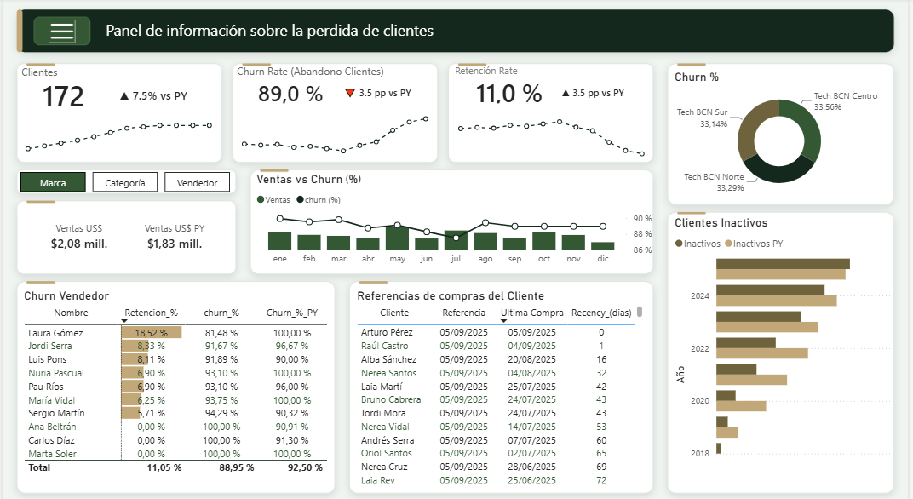

# Panel 3 — Abandono de clientes (churn) y retención

Responde **dónde se está perdiendo dinero por clientes que dejan de comprar**: cuántos clientes están en abandono, cómo evoluciona frente al año anterior y por vendedor.



## Definición de negocio

> Un cliente está en **churn** si han pasado **al menos N días** desde su última compra (N = umbral elegido con el control "Umbral"; en el panel final, **120 días**).

```
churn_%      = clientes en churn / clientes totales
retencion_%  = 1 - churn_%
```

La fecha de corte es la **última venta de los datos (05/09/2025)**, no `TODAY()`: así el reporte da el mismo resultado hoy y dentro de un año.

## KPI y visuales

| Visual | Qué muestra | Medidas | Código |
|---|---|---|---|
| Tarjeta "Clientes" | **172** clientes, ▲ 7.5 % vs año anterior; minigráfico de evolución | `clientes_totales`, `Clientes_Totales_Vs_PY_texto`, `Clientes_Totales_(serie)` | [`clientes_totales.dax`](../../codigo/dax/Medidas_churn/clientes_totales.dax), [`clientes_totales_vs_py_texto.dax`](../../codigo/dax/Medidas_Clientes_Activos/clientes_totales_vs_py_texto.dax) |
| Tarjeta "Churn Rate" | **89.0 %** (88.95 %), 3.5 pp menos que el año anterior | `churn_%`, `Churn_%_vs_PY_(texto)`, `Churn_%_(serie)` | [`churn_pct.dax`](../../codigo/dax/Medidas_churn/churn_pct.dax), [`churn_pct_vs_py_texto.dax`](../../codigo/dax/Medidas_Rate/churn_pct_vs_py_texto.dax) |
| Tarjeta "Retención Rate" | **11.0 %** (11.05 %), ▲ 3.5 pp | `Retencion_%`, `Retencion_%_vs_PY_texto`, `Retencion_%_(serie)` | [`retencion_pct.dax`](../../codigo/dax/Medidas_churn/retencion_pct.dax), [`retencion_pct_serie.dax`](../../codigo/dax/Medidas_Serie/retencion_pct_serie.dax) |
| "Ventas US$" y "Ventas US$ PY" | $2,08 mill. y $1,83 mill. | `ventas_totales`, `ventas_totales_ly` | [`ventas_totales_ly.dax`](../../codigo/dax/Medidas_Inteligencia_Tiempo/ventas_totales_ly.dax) |
| "Ventas vs Churn (%)" | Barras de ventas por mes y línea de churn | `ventas_totales`, `churn_%` | — |
| Dona "Churn %" | Churn por agencia (≈ 33 % cada una) | `clientes_con_churn` por agencia | [`clientes_con_churn.dax`](../../codigo/dax/Medidas_churn/clientes_con_churn.dax) |
| "Clientes Inactivos" | Inactivos frente a inactivos del año anterior, por año | `Clientes_Inactivos_(serie)` | [`clientes_inactivos_serie.dax`](../../codigo/dax/Medidas_Serie/clientes_inactivos_serie.dax) |
| Tabla "Churn Vendedor" | Retención, churn y churn del año anterior por vendedor | `Retencion_%`, `churn_%`, `Churn_%_PY` | [`churn_pct_py.dax`](../../codigo/dax/Medidas_Rate/churn_pct_py.dax) |
| Tabla "Referencias de compras del cliente" | Fecha de referencia, última compra y días desde ella (recencia) | `Fecha_Ref`, `ultima_compra_cliente`, `Recency_(dias)` | [`recency_dias.dax`](../../codigo/dax/Medidas_churn/recency_dias.dax) |
| Botones Marca / Categoría / Vendedor | Cambian la dimensión del análisis | — | — |

## Cómo se implementó (la cadena de medidas)

```
Fecha_Ref -> ultima_compra_cliente -> Recency_(dias) -> churn_flag
          -> clientes_con_churn -> churn_% -> Retencion_%
```

1. [`Fecha_Ref`](../../codigo/dax/Medidas_churn/fecha_ref.dax): la fecha de corte, nunca posterior a la última venta.
2. [`ultima_compra_cliente`](../../codigo/dax/Medidas_churn/ultima_compra_cliente.dax): última compra de cada cliente.
3. [`Recency_(dias)`](../../codigo/dax/Medidas_churn/recency_dias.dax): la R de RFM.
4. [`churn_flag`](../../codigo/dax/Medidas_churn/churn_flag.dax): 1 si la recencia es ≥ umbral.
5. [`clientes_con_churn`](../../codigo/dax/Medidas_churn/clientes_con_churn.dax) suma los flags cliente por cliente; [`churn_%`](../../codigo/dax/Medidas_churn/churn_pct.dax) los divide entre los clientes totales.
6. **Año anterior:** [`Fecha_Ref_PY`](../../codigo/dax/Medidas_Rate/fecha_ref_py.dax) y [`ultima_compra_a_fecha_PY`](../../codigo/dax/Medidas_Rate/ultima_compra_a_fecha_py.dax) recalculan el churn con lo que se sabía el 05/09/2024.
7. **Series:** las medidas `(serie)` usan el corte de cada punto del eje para dibujar los minigráficos.
8. **Textos con flecha:** variación en **puntos porcentuales** (pp).

## El umbral importa más que cualquier medida

| Umbral (días) | Clientes en churn | Churn | Retención |
|---|---|---|---|
| 30 | 169 | 98.26 % | 1.74 % |
| 60 | 164 | 95.35 % | 4.65 % |
| 90 | 156 | 90.70 % | 9.30 % |
| **120 (panel)** | **153** | **88.95 %** | **11.05 %** |
| 180 | 143 | 83.14 % | 16.86 % |

La mediana entre dos compras de un mismo cliente es de ~669 días (~22 meses). Con un umbral de 120 días medimos "no ha vuelto en 4 meses", no "se fue para siempre". **89 % no significa perder 9 de cada 10 clientes**: significa que el ciclo de compra de este negocio es largo. Por eso el umbral debe definirse con el negocio.

## Hallazgos del panel

- **172 clientes**, 7.5 % más que el año anterior.
- **Churn 88.95 %** frente a 92.50 % del año anterior: mejora de **3.5 pp**.
- Mejor retención por vendedor: Laura Gómez (18.52 %). Con 0 % de retención aparecen Ana Beltrán, Carlos Díaz y Marta Soler; antes de sacar conclusiones sobre personas conviene revisar el tamaño de su cartera y el ciclo de compra.
- Las tres agencias aportan casi lo mismo al churn (33.1–33.6 %): el abandono no es un problema de una sola agencia.

## Errores que encontré en este panel

| Problema | Causa | Solución |
|---|---|---|
| El mismo reporte daba 5.23 % de retención un día y 0 % meses después | `Fecha_Ref` usaba `TODAY()` | Anclarla a la última venta |
| Las flechas "vs PY" siempre salían 🔺 | Se calculaban con el valor del año anterior (siempre ≥ 0) | Variación = actual − PY, en pp |
| El churn PY salía inflado | `ultima_compra_cliente` ignora la fecha y mira compras posteriores al corte PY | `ultima_compra_a_fecha_PY` |
| Churn falso en los meses sin ventas | Calendario más largo que los datos | `BLANK()` después de la última venta (usa `MIN`, no `MAX`) |

Detalle completo en [`docs/05_lecciones_aprendidas.md`](../../docs/05_lecciones_aprendidas.md).

## Por qué pp y no %

Para tasas (churn, retención, margen) la variación se expresa en **puntos porcentuales**: de 92.5 % a 89.0 % son **−3.5 pp**. Un porcentaje relativo (−3.8 %) se presta a confusión. Para conteos y montos (clientes, ventas) sí se usa el % relativo, como en la tarjeta de clientes (+7.5 %).


## Cómo verificar las cifras

```bash
python codigo/python/validar_churn.py --umbral 120 --modo correcto        # 88.95 %, PY 92.50 %
python codigo/python/validar_churn.py --sensibilidad 30,60,90,120,180     # la tabla de arriba
python codigo/python/ejecutar_sql.py --umbral 120 --comparar              # SQL frente a pandas
```

← [Panel 2](../02_detalle_ventas_global/README.md) · [README principal](../../README.md) · Siguiente: [Panel 4 — Reactivación](../04_reactivacion_clientes/README.md)
