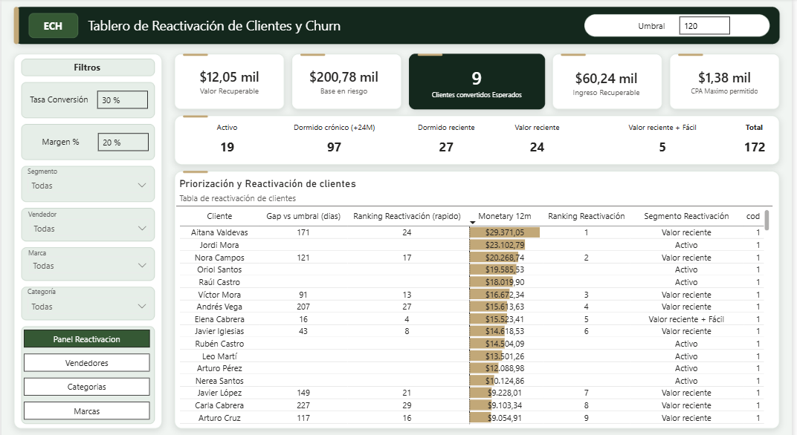

# Panel 4 — Reactivación de clientes

Convierte el churn en un **plan de acción**: a qué clientes llamar primero, cuánto dinero se puede recuperar y **cuánto se puede gastar como máximo** en recuperarlos sin perder dinero.



## Qué pregunta responde

- ¿Qué clientes en abandono son los más **viables** de recuperar?
- ¿Cuánto dinero hay en riesgo y cuánto podríamos recuperar?
- ¿Cuál es el **CPA máximo** (costo por cliente recuperado) que hace rentable la campaña?

## Controles (parámetros)

| Control | Valor inicial | Para qué sirve | Código |
|---|---|---|---|
| Umbral | 120 días | Cuántos días sin comprar definen el abandono | [`Churn_Umbral.dax`](../../codigo/dax/parametros/Churn_Umbral.dax) |
| Tasa de conversión | 30 % | Supuesto de cuántos clientes en churn se recuperan | [`Tasa_conversion.dax`](../../codigo/dax/parametros/Tasa_conversion.dax) |
| Margen % | 20 % | Supuesto del margen sobre el ingreso recuperado | [`Margen_pct.dax`](../../codigo/dax/parametros/Margen_pct.dax) |
| Segmento, vendedor, marca, categoría | Todas | Filtros de la tabla | [`Cliente_Segmento.dax`](../../codigo/dax/parametros/Cliente_Segmento.dax) |

## KPI (de arriba hacia abajo en el cálculo)

| Tarjeta | Valor | Cómo se calcula | Código |
|---|---|---|---|
| Base en riesgo | **$200,78 mil** | Compras de 12 meses de los clientes en churn que sí compraron (29 clientes) | [`base_en_riesgo_12m.dax`](../../codigo/dax/Medidas_Reactivacion/base_en_riesgo_12m.dax) |
| Ingreso recuperable | **$60,24 mil** | Base en riesgo × conversión (30 %) | [`ingreso_recuperable_12m.dax`](../../codigo/dax/Medidas_Reactivacion/ingreso_recuperable_12m.dax) |
| Valor recuperable | **$12,05 mil** | Ingreso recuperable × margen (20 %) | [`valor_recuperable_potencial.dax`](../../codigo/dax/Medidas_Reactivacion/valor_recuperable_potencial.dax) |
| Clientes convertidos esperados | **9** (8.7) | 29 clientes objetivo × 30 % | [`clientes_convertidos_esperados.dax`](../../codigo/dax/Medidas_Reactivacion/clientes_convertidos_esperados.dax) |
| CPA máximo permitido | **$1,38 mil** | Valor recuperable ÷ clientes esperados | [`cpa_maximo_permitido_break_even.dax`](../../codigo/dax/Medidas_Reactivacion/cpa_maximo_permitido_break_even.dax) |

Cómo leerlo: **no conviene gastar más de ≈ $1,38 mil por cada cliente recuperado, ni más de ≈ $415 por cada cliente contactado** (1,38 mil × 30 %). Por encima de eso, la campaña pierde dinero. El CPA máximo no depende de la tasa de conversión (se cancela); lo que cambia con ella es *cuántos* clientes se recuperan.

> Los importes están en la moneda del tablero y **con IVA incluido**. Para decisiones de margen reales conviene usar `ventas_netas` (sin IVA): la base bajaría ≈ 13 %.

## Segmentos

| Segmento | Regla | Clientes |
|---|---|---|
| Activo | No está en churn | 19 |
| **Valor reciente + Fácil** | En churn, compró en los últimos 12 meses y cruzó el umbral hace ≤ 30 días | 5 |
| **Valor reciente** | En churn y compró en los últimos 12 meses | 24 |
| Dormido reciente | En churn, sin compras en 12 meses, última compra hace menos de 24 meses | 27 |
| Dormido crónico (+24M) | Más de 24 meses sin comprar | 97 |
| **Total** | | **172** |

Los 29 clientes con valor reciente (24 + 5) son la **población objetivo**. Los dormidos aportan cero a la base de 12 meses: no se les asigna presupuesto.

Seis clientes concentran el **56 %** de la base: Aitana Valdevas, Nora Campos, Víctor Mora, Andrés Vega, Elena Cabrera y Javier Iglesias.

## Cómo se priorizan: dos rankings

| Ranking | Pregunta | Medida |
|---|---|---|
| **Rápido** | ¿Quién cruzó el umbral hace menos tiempo? (más "caliente", más fácil) | [`Ranking_Reactivacion_(rapido)`](../../codigo/dax/Medidas_Reactivacion/ranking_reactivacion_rapido.dax) sobre [`Gap_vs_umbral_(dias)`](../../codigo/dax/Medidas_Reactivacion/gap_vs_umbral_dias.dax) |
| **Valor** | ¿Quién ha comprado más en los últimos 12 meses? | [`Ranking_Reactivacion_(valor 12m)`](../../codigo/dax/Medidas_Reactivacion/ranking_reactivacion_valor_12m.dax) sobre [`Monetary_12m`](../../codigo/dax/Medidas_Reactivacion/monetary_12m.dax) |

Son dos preguntas distintas: un cliente puede ser fácil y poco valioso (Marina Méndez: gap de 2 días, valor ranking 25 de 29) o difícil y muy valioso (Aitana Valdevas: gap de 171 días, ranking de valor 1). El mejor objetivo cumple las dos cosas (Elena Cabrera: gap 16, ranking de valor 5).

## Cómo se construyó

1. **Parámetros** con *Modelado > Nuevo parámetro* (umbral, conversión, margen) y una tabla desconectada para los segmentos.
2. **`Gap_vs_umbral_(dias)`** = recencia − umbral, solo para clientes en churn.
3. **`Monetary_12m`** = ventas de los 12 meses que terminan en `Fecha_Ref` (`DATESINPERIOD`).
4. **Rankings** con `RANKX` sobre una tabla virtual de clientes (`ADDCOLUMNS` + `FILTER`).
5. **`Segmento_Reactivacion`** con un `SWITCH(TRUE(), ...)` por prioridad.
6. **Segmentador por tabla desconectada:** como los segmentos son un resultado calculado y no una columna, se crea una tabla con los nombres y la medida [`Filtro_Segmento_Reactivacion`](../../codigo/dax/Medidas_Reactivacion/filtro_segmento_reactivacion.dax) (1 = mostrar) se coloca en *Filtros de este visual* con valor 1.
7. **KPI de ROI** encadenados: base → ingreso → valor → clientes → CPA.

## Errores que encontré en este panel

### 1. El ranking de valor salía `1, 1, 1...` para todos

**Causa.** La medida iteraba sobre `ALLSELECTED(Analisis_Ventas[Cliente])`, pero la tabla muestra `DIM_Clientes[Cliente]`. El filtro de la fila viaja de la dimensión a la tabla de hechos y deja a cada cliente solo en su propia lista; `RANKX` lo compara contra sí mismo y siempre da 1.
**Solución.** Iterar sobre `ALLSELECTED(DIM_Clientes[Cliente])`, la misma columna que se muestra (como ya hacía el ranking rápido).

### 2. Los clientes convertidos esperados no cuadraban con el valor

La versión original multiplicaba la conversión por **todos** los clientes en churn (153 × 30 % = 46), pero la base de dinero solo incluía a los 29 con compras en 12 meses. El CPA salía ≈ 5 veces más bajo (≈ $263 en lugar de ≈ $1,38 mil). **Solución:** que numerador y denominador usen la misma población (29 × 30 % = 8.7).

### 3. "Dormido reciente" nunca aparecía

Quien no tiene compras en 12 meses tiene por definición una recencia ≥ 365 días, así que la regla "≥ 365 = dormido crónico" absorbía a todos. **Solución:** cortar el dormido a 24 meses (≈ la mediana entre compras): 27 dormidos recientes y 97 crónicos.

### 4. Al elegir "Dormido crónico" en el segmentador no salía nada

El texto de la tabla del segmentador decía "(+12M)" y la medida devolvía "(+24M)". El filtro compara texto, y deben ser **idénticos**.

### 5. Fila de total mal calculada

El total mostraba el segmento "Activo" y un conteo absurdo. **Solución:** `Segmento_Reactivacion` devuelve vacío en el total (`HASONEVALUE`) y `Clientes_por_segmento` cuenta a todos cuando no hay un segmento elegido (suma 172).

## Supuestos y límites

- La conversión (30 %) y el margen (20 %) son supuestos de trabajo; con un piloto se calibrarían.
- La base usa ventas **con IVA**; el margen debería aplicarse a la venta neta.
- Con 29 clientes objetivo, 9 esperados y poca historia, cualquier cifra es una estimación gruesa.

## Cómo verificar las cifras

Recálculo independiente (umbral 120, fecha 05/09/2025): 153 clientes en churn, **29** con compras en 12 meses, 24 + 5 en los segmentos de valor; ranking de valor: Aitana Valdevas, Nora Campos, Víctor Mora, Andrés Vega, Elena Cabrera, Javier Iglesias.

```bash
python codigo/python/validar_churn.py --umbral 120 --iva 0.15 --modo correcto
```

← [Panel 3](../03_abandono_clientes/README.md) · [README principal](../../README.md)

